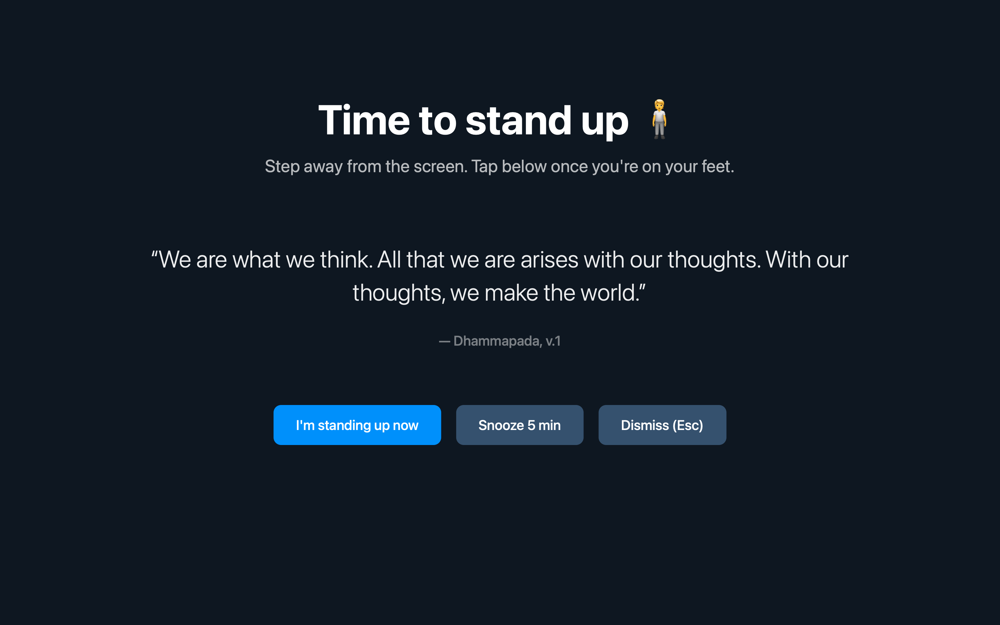

# StandYouUp


[](https://github.com/rcheesley/standyouup/actions/workflows/ci.yml)
[](LICENSE)


A tiny native macOS menu-bar app that makes you stand up on a schedule. Every
hour (configurable) it throws a **full-screen overlay across all your displays**
— above the menu bar and even over full-screen apps — with a verse from the
Dhammapada, telling you to stand up. It won't clear until you act, then it
reminds you when you can sit down again.

No Dock icon, no window clutter — it lives quietly in the menu bar.



## Features

- **Full-screen stand/sit prompts** on every connected display.
- **Interactive cycle** — tap *I'm standing up now*, and it reminds you to sit
  after your chosen stand length; tap *I'm sitting down now* and the cycle
  repeats.
- **Working hours** — restrict reminders to per-day shifts (supports split
  shifts, e.g. mornings and afternoons). Outside your hours it goes quiet.
- **Escape hatches** — *Snooze 5 min* and an instant *Dismiss (Esc)* so it never
  traps you during a call.
- **Chime + system notification** with selectable sound and volume.
- **Daily rest counter**, **compact menu-bar mode**, and **start at login**.
- A random Dhammapada verse on each prompt.

## Requirements

- macOS 13 (Ventura) or later.
- **Xcode Command Line Tools** to build the app (`xcode-select --install`).
  Full Xcode is only needed to run the unit tests (which use XCTest).

## Install

1. Download `StandYouUp-<version>.dmg` from the
   [latest release](https://github.com/rcheesley/standyouup/releases/latest).
   (Not "Source code", which is a copy of this repository.)
2. Open it and drag **StandYouUp** onto the **Applications** folder.
3. Open StandYouUp from Applications. macOS will block it the first time, as the
   app isn't notarized yet. Click **Done**, then open **System Settings**, go to
   **Privacy & Security**, scroll down and click **Open Anyway** next to
   StandYouUp. You only need to do this once.

Run the app from Applications before turning on **Start at login**, so macOS
remembers the right copy.

## Build from source

```bash
git clone https://github.com/rcheesley/standyouup.git
cd standyouup
./build.sh
open StandYouUp.app
```

The app appears in your menu bar. `build.sh` compiles the SwiftPM executable and
wraps it into `StandYouUp.app`.

A plain build targets the Mac you're on. Release downloads are universal (Apple
Silicon and Intel), built with `UNIVERSAL=1 ./build.sh`, which needs full Xcode.

An app you build yourself runs directly. Copy it to your Applications folder if
you want to use **Start at login**, as `build.sh` replaces the app in this folder
on every build.

`DMG=1 ./build.sh` also wraps the app in a `StandYouUp-<version>.dmg` disk image.

## Usage

Click the menu-bar icon for:

- **Stand up now** / **Sit down now** (⌘S) — while sitting, trigger a stand
  prompt immediately; while standing, sit back down early and restart the cycle
- **Pause reminders** — for 30 minutes, 1 hour, 2 hours, until tomorrow, or until
  you resume them yourself
- **Sit for** — 30 / 45 / 60 / 90 minutes
- **Stand for** — 5 / 10 / 15 / 20 / 30 minutes
- **Working hours…** — set per-day shifts; if any day has hours, reminders run
  only during them. Format: `09:00-12:30, 13:30-17:00`. Blank = day off; all
  days blank = remind all day. A shift can end at `24:00`, and one that ends
  earlier than it starts (`22:00-06:00`) runs into the next day. Outside your
  hours the menu bar shows a moon icon.
- **Sound** / **Volume** — chime selection (or Off) with a *Test sound* item
- **Compact menu bar (icon only)** — keeps the item narrow on a crowded bar
- **Start at login**
- **Quit** (⌘Q)

Preferences persist in `UserDefaults`; a few can be overridden directly:

```bash
defaults write uk.co.silavapi.StandYouUp sitMinutes 45
defaults write uk.co.silavapi.StandYouUp standMinutes 15
```

## Project layout

```
Package.swift                 SwiftPM manifest
Sources/
  StandYouUpCore/             Pure, UI-free logic (working hours, the sit/stand
                              cycle) — unit-tested
  StandYouUp/                 The AppKit menu-bar app
    main.swift                Entry point
    AppDelegate.swift         Lifecycle, menu, and carrying out what the cycle asks
    Overlay.swift             Full-screen break overlay
    PreferencesWindow.swift   Working-hours settings window
    Config.swift              UserDefaults keys & shared constants
    Verses.swift              Dhammapada verse data
Tests/StandYouUpCoreTests/    XCTest suite for the core logic
Resources/AppIcon.icns        App icon (regenerate with Icon/make-icns.sh)
Icon/                         Icon generator (Swift) + make-icns.sh
build.sh                      Builds StandYouUp.app
```

## Tests

```bash
swift test
```

(Requires full Xcode for XCTest; runs in CI on every push and PR.)

## Attribution

The on-screen verses are from *Dhammapada: The Way of Truth*, translated from
the Pāli by Sangharakshita (Windhorse Publications, 2001), © Sangharakshita 2001.
The [Dhammapada](https://en.wikipedia.org/wiki/Dhammapada) is an ancient Buddhist
text. The translation can be read in full at [dhammapada.at](https://dhammapada.at/).

## Contributing

Issues and pull requests welcome — see [CONTRIBUTING.md](CONTRIBUTING.md) and the
[Code of Conduct](CODE_OF_CONDUCT.md).

## License

[GPL-3.0-or-later](LICENSE) © Sīlavāpi Cheesley and contributors.
